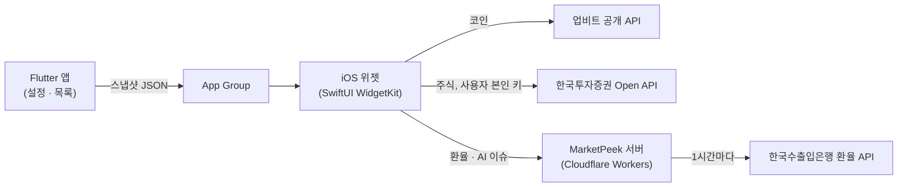

# MarketPeek

> 잠금화면 위젯 하나로 코인 · 주식 · 환율 · 어제 시장 이슈를 바로 보는 iOS 시세 앱

**"위젯이 제품이다."** 앱은 위젯에 무엇을 어떻게 보여줄지 정하는 설정 도구이고, 실제로 매일 보는 화면은 잠금화면과 홈 화면 위젯입니다.

## 주요 기능

- **위젯 5종**: 코인 · 미국주식 · 환율 · AI 어제 이슈 · 홈 2×2 자유 구성(칸마다 코인·주식·환율 선택)
- **미국주식 원화 환산**: USD 가격과 USD/KRW 기준 원화 환산가를 함께 표시
- **환율 통화 선택**: USD · JPY(100엔) · EUR · THB · CNY
- **검색과 목록 관리**: 코인 · 국내주식 · 미국주식 전체 종목 검색, 위젯 편집(길게 누르기)에서 표시 순서 선택
- **갱신 시각 표시**: 위젯마다 "N분 전" 표시, 홈 위젯 새로고침 버튼(iOS 17), 장 시간에 맞춘 갱신 요청
- **잠금화면 단색 대응**: 등락을 색뿐 아니라 ▲▼ 기호로 구분, 상승·하락 색 한국식/해외식 선택
- **AI 어제 이슈** (만드는 중): 전날 시장이 "무엇이 왜 움직였는지" 한 줄 요약. 종목 추천·투자 권유 표현은 쓰지 않습니다.

## 구조



- 앱에서 설정을 바꾸면 App Group에 스냅샷을 쓰고 위젯을 다시 그립니다.
- 위젯은 타임라인을 만들 때 시세를 직접 받아 최신 값으로 덮어씁니다.
- 주식은 서버를 거치지 않고 기기에서 사용자 본인의 증권사 키로 받습니다(키는 기기 Keychain에만 저장).
- 우리 서비스의 API 키는 앱에 넣지 않고 서버에만 둡니다.

## 기술 스택

| 영역 | 기술 |
|---|---|
| 앱 | Flutter (Dart), `ChangeNotifier`, shared_preferences |
| 위젯 | SwiftUI WidgetKit, AppIntent (위젯 iOS 17+, 앱 iOS 16+) |
| 서버 | Cloudflare Workers (TypeScript), KV 캐시, 매시간 cron, Vitest |
| 시세 | 업비트(코인), 한국투자증권 Open API(주식), 한국수출입은행(환율) |

## 폴더 구조

```
lib/                     Flutter 앱 (모델, 시세 저장소, 상태, 화면, 위젯 동기화)
ios/MarketPeekWidget/    iOS 위젯 확장 (SwiftUI)
server/                  시세 · AI 이슈 서버 (Cloudflare Workers)
assets/stocks/           국내 · 미국 전체 종목 목록
tool/                    종목 목록 생성 스크립트
```

## 실행 방법

### 앱

```sh
flutter pub get
flutter run --dart-define=API_BASE_URL=<서버 주소>
```

- 서버 주소를 넣지 않으면 환율 · AI 이슈는 예시 값을 씁니다.
- 주식 시세는 앱 설정에서 한국투자증권 키를 넣어야 나옵니다(신청 방법: [`key.md`](key.md)). 키가 없으면 예시 값을 씁니다.
- 잠금화면 위젯은 시뮬레이터나 실기기에서 직접 추가해 확인합니다.

### 서버

```sh
cd server
npm install
npm test        # 단위 테스트 (외부 API는 부르지 않음)
npm run dev     # http://localhost:8787
```

배포 방법, API 응답 형식, 무료 플랜 한도는 [`server/README.md`](server/README.md)에 있습니다.

## 팀

| 이름 | 역할 |
|---|---|
| 장찬범 ([@jcb5039](https://github.com/jcb5039)) | 앱 · 위젯 (Flutter, iOS) |
| 윤혁주 ([@YoonHyukJu](https://github.com/YoonHyukJu)) | 백엔드 서버 · AI |
| 이효원 | Frontend(App) · UI/UX Design |

## 아이콘 출처

위젯의 코인 아이콘(`ios/MarketPeekWidget/Assets.xcassets/coin-*`)은 [spothq/cryptocurrency-icons](https://github.com/spothq/cryptocurrency-icons) v0.18.1 (CC0-1.0)에서 가져왔습니다.
주식 로고는 위젯이 기기에서 [Financial Modeling Prep](https://financialmodelingprep.com) 이미지 주소로 받아 App Group에 저장해 쓰며, 저장소에는 넣지 않습니다.
각 코인·회사 로고는 해당 소유자의 상표입니다. 이 앱은 출시하지 않는 포트폴리오용입니다.
